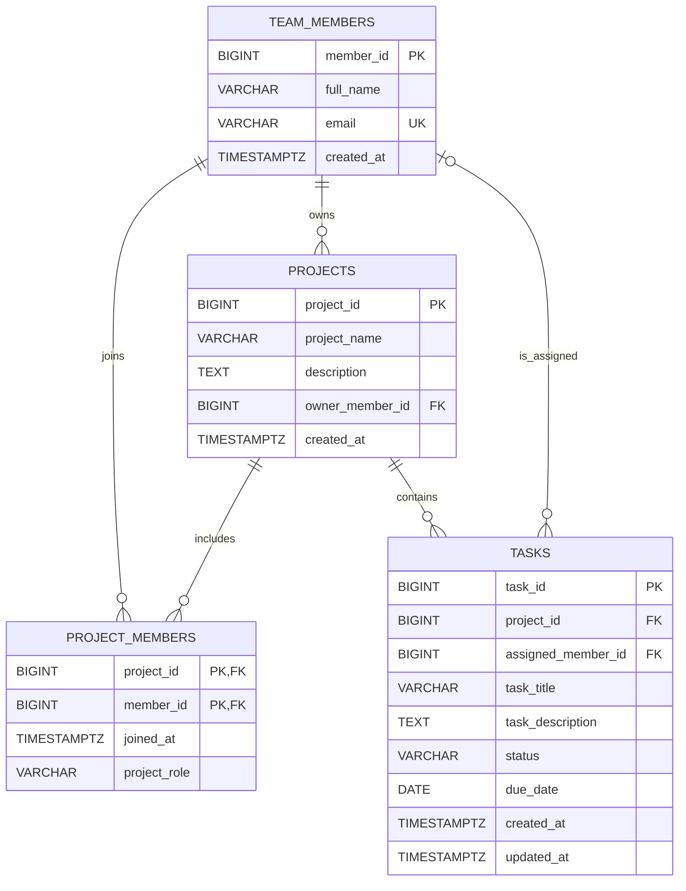

# TaskSphere corrected ER diagram

## Relationship summary
- One team member can own many projects; each project has one owner.
- Projects and team members have a many-to-many relationship through `project_members`.
- One project contains many tasks; each task belongs to one project.
- A team member can be assigned many tasks. A task may be unassigned or assigned to one member.
- `project_members` uses a composite primary key so the same member cannot be added to the same project twice.
