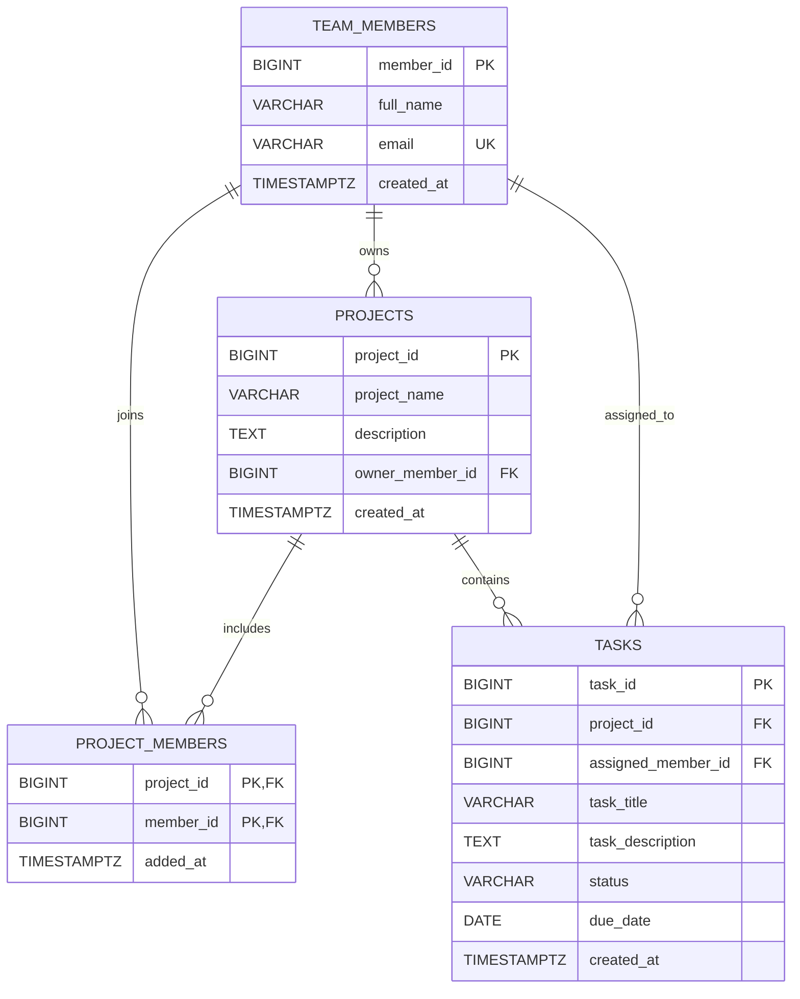

# TaskSphere corrected ER diagram

Paste the Mermaid source below, without the Markdown fences, into Mermaid Live to render it.

## Relationships and constraints

- A team member may own zero or more projects; every project has exactly one owner.
- Projects and team members have a many-to-many membership relationship through `project_members`. Its `(project_id, member_id)` composite primary key prevents a member from joining the same project more than once.
- Each task belongs to exactly one project. A member may be assigned many tasks, while a task may be unassigned or assigned to one member.
- `team_members.email` is unique. Task status is restricted to `todo`, `in_progress`, `done`, or `blocked`.
- The ERD shows all columns, primary keys, unique email, foreign keys, and relationships. Nullability, default values, check constraints, and deletion/update actions are defined in [schema.sql](schema.sql).
